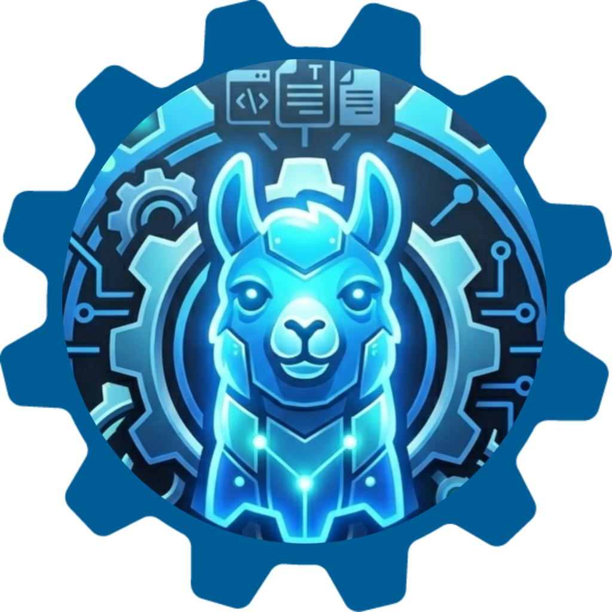

# 🦙 Ollama Forge

A lightweight, **zero-dependency** web UI and CLI for managing [Ollama](https://ollama.com):

- start/stop the Ollama server
- browse, inspect, pull, create, push and remove models
- chat with any installed model to test it
- sign in/out to ollama.com
- install, upgrade, version-check and uninstall the Ollama binary itself

The backend is plain Node.js (standard library only) and the frontend is vanilla
HTML/CSS/JS — no frameworks and no runtime dependencies. Everything can also be
compiled into a **single self-contained executable** (Node's SEA), with the UI
embedded inside the binary.



## Requirements

- [Node.js](https://nodejs.org/) **18 or newer** to run from source (uses the
  built-in global `fetch`)
- [Node.js](https://nodejs.org/) **24 or newer** to compile the single-file
  binary (uses the Single Executable Application tooling)
- [Ollama](https://ollama.com/download) installed locally (optional — Ollama Forge can install it for you)

## Quick start

```bash
npm start
```

Then open <http://127.0.0.1:11435>.

To listen on a different address/port:

```bash
FORGE_HOST=0.0.0.0 FORGE_PORT=8080 npm start
```

## CLI

The CLI mirrors the web UI's Manage tab. Run it via the unified entry
(`main.js`), the dedicated `cli.js`, the npm script, or the built binary:

```bash
node main.js install    # Install Ollama
node main.js upgrade    # Upgrade Ollama to the latest release
node main.js update     # Check current vs. latest version
node main.js uninstall  # Remove Ollama from the system

node cli.js update       # equivalent, CLI-only entry
npm run cli -- update     # equivalent, via npm
./dist/ollama-forge update   # equivalent, from the compiled binary
```

With no arguments, `main.js` (and the compiled binary) starts the web UI instead.
An unknown command prints help and exits non-zero.

## Single-file binary

Build a self-contained executable with no runtime dependencies — Node, the
backend, and the web UI all bundled into one file:

```bash
npm install          # installs the two build-time dev deps (esbuild, postject)
npm run build        # -> dist/ollama-forge   (dist/ollama-forge.exe on Windows)
```

The binary is a drop-in replacement for both entry points:

```bash
./dist/ollama-forge          # start the web UI
./dist/ollama-forge update   # run a CLI command
```

`npm run build:bundle` produces only the bundled `dist/ollama-forge.cjs`
(useful for inspecting the bundle without injecting a native binary).

### How it works

1. `build.mjs` embeds everything in `public/` and bundles `main.js` (plus `lib/`)
   into a single CommonJS file with [esbuild](https://esbuild.github.io/).
2. Node's `--experimental-sea-config` turns that bundle into a SEA blob.
3. [postject](https://github.com/nodejs/postject) injects the blob into a copy of
   the `node` runtime, producing the final binary.

`esbuild` and `postject` are **build-time only**; the produced binary has no
dependencies.

### Prebuilt binaries in CI

`.github/workflows/build.yml` builds and uploads a binary for every supported
platform on each push/PR, and attaches them to a GitHub Release when a `v*` tag
is pushed:

| Target | Runner |
| --- | --- |
| `linux-x64` | `ubuntu-latest` |
| `linux-arm64` | `ubuntu-24.04-arm` |
| `macos-arm64` | `macos-latest` |
| `macos-x64` | `macos-15-intel` |
| `windows-x64` | `windows-latest` |
| `windows-arm64` | `windows-11-arm` |

## Features

### Models tab
- **Server control** — start/stop `ollama serve` with live status polling.
- **Pull** — with autocomplete suggestions for popular models; streamed progress.
- **Create** — build a model from a Modelfile (type it inline or browse for a file).
- **Push / Remove** — publish to or delete from your local library.
- **Details** — base model, format, family, quantization, size and digest.
- **Auth** — sign in (opens your browser) and sign out of ollama.com.

### Manage tab
- **Binary path** — auto-detect, browse, or set the `ollama` executable path.
- **Version** — shows installed vs. latest release.
- **Install / Upgrade / Uninstall** — with streamed output and cancellation.

### Chat tab
- **Run a model** — pick any installed model from the dropdown to test it.
- **Streaming replies** — tokens arrive live; reasoning/`thinking` output (for
  models like Qwen3 and DeepSeek-R1) is shown in a collapsible block.
- **Multi-turn memory** — the whole conversation is sent back each turn.
- **Stop / New Chat** — cancel a generation mid-stream or reset the transcript.
- **Stats** — token count and tokens/sec for each reply.

This tab drives the model through Ollama's `/api/chat` streaming endpoint — the
same engine `ollama run` uses under the hood — so what you test here matches the
CLI, with clean streamed output instead of a terminal REPL.

## Configuration

Settings live in `~/.ollama_gui/settings.json`:

```json
{
  "ollama_host": "http://localhost:11434",
  "ollama_bin": "/usr/local/bin/ollama"
}
```

- **`ollama_host`** — base URL of the Ollama API. Falls back to the `OLLAMA_HOST`
  environment variable, then `http://localhost:11434`.
- **`ollama_bin`** — path to the `ollama` binary. Auto-detected from `PATH` (and
  common install locations) when unset.

## HTTP API

All endpoints are JSON. `POST /api/run` returns a stream of newline-delimited
JSON (`application/x-ndjson`) for long-running tasks.

| Method | Endpoint | Description |
| --- | --- | --- |
| `GET`  | `/api/state` | Server status, auth, binary path, host |
| `GET`  | `/api/models` | List installed models |
| `GET`  | `/api/show?name=<model>` | Model details |
| `GET`  | `/api/manage-version` | Installed and latest Ollama versions |
| `GET`  | `/api/detect` | Auto-detected `ollama` binary path |
| `GET`  | `/api/fs?path=<dir>` | List a directory (file browser) |
| `GET`  | `/api/read?path=<file>` | Read a text file |
| `POST` | `/api/settings` | Persist `{ "ollama_bin": "..." }` |
| `POST` | `/api/run` | Run a task (see below) |
| `POST` | `/api/cancel` | Cancel the active task |

Tasks for `POST /api/run` (body `{ "task": "..." }`):

`pull` · `push` · `create` · `chat` · `remove` · `serve-start` · `serve-stop` ·
`signin` · `signout` · `manage`

`manage` takes an extra `"action"`: `update` | `install` | `upgrade` | `uninstall`,
and an optional `"password"` for `sudo` on Linux/macOS.

`chat` takes `"model"` and a `"messages"` array (`[{ "role": "user", "content": "…" }]`)
and streams NDJSON frames: `{ "stream": "chat", "type": "thinking" | "content" | "stats", … }`.
Cancel an in-flight chat with `POST /api/cancel`.

## Platform notes

- **Linux / macOS** — installing, upgrading and uninstalling uses the official
  `install.sh` and requires `sudo`. The web UI prompts for your password when
  needed; the CLI uses `sudo` interactively.
- **Windows** — installs per-user via the official `OllamaSetup.exe` (no admin
  rights required) and uninstalls through the registered uninstaller.

## Security

The server binds to `127.0.0.1` by default. `/api/fs` and `/api/read` expose
local filesystem reads to power the in-app file browser, so **only change
`FORGE_HOST` to a non-loopback address if you understand and accept that risk**.

## Project structure

```
.
├── main.js           # unified entry: web UI by default, CLI with a command
├── server.js         # zero-dependency HTTP backend + static host
├── cli.js            # command-line manager
├── build.mjs         # single-file binary build (bundle + SEA + inject)
├── lib/
│   ├── helpers.js    # config, binary detection, auth parsing, formatting
│   ├── exec.js       # child_process wrappers + streaming
│   ├── ollama.js     # Ollama HTTP API client
│   ├── manage.js     # install/upgrade/uninstall/version logic
│   └── assets.js     # front-end assets (disk or embedded in the binary)
├── public/
│   ├── index.html    # web UI markup
│   ├── style.css     # web UI styles
│   └── app.js        # web UI logic (vanilla JS)
└── .github/
    └── workflows/
        └── build.yml # multi-OS binary build + release
```

Build output is written to `dist/` (git-ignored).

## License

[MIT](LICENSE)
